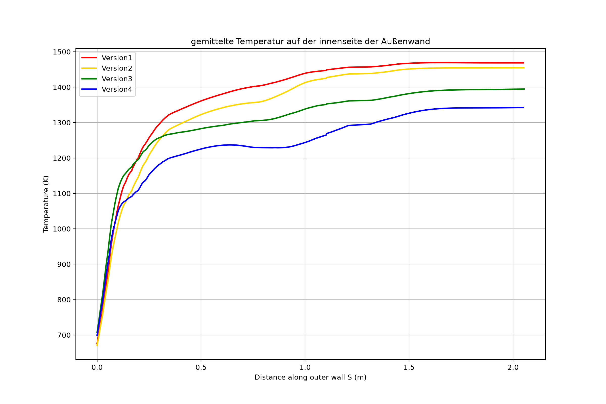

# cfdpost – Python-Auswertung der Außenwandtemperatur

Kleines Python-Projekt zur Nachbearbeitung von Ansys-Fluent-Exporten aus meiner Masterarbeit
([CHT-Simulation einer H₂/O₂-Brennkammer](https://pouria-kamali.de/projekt-masterarbeit.php)).
Da in der Arbeit kein CFD-Post zur Verfügung stand, wurden die Knotenwerte als CSV exportiert und in Python ausgewertet.

Aus den Exporten mehrerer Geometrievarianten (V1–V4) wird die Temperatur entlang der Innenseite der Außenwand
(vertikaler Abschnitt → 90°-Bogen → horizontaler Abschnitt) über der Lauflänge S aufgetragen und als Diagramm sowie als Zahlentabelle ausgegeben.

## Vorgehen

1. **Geometrie:** Kreis-Fit (kleinste Quadrate) an den Knoten im Bogenbereich der Referenzversion (V1), danach erneuter Fit an die jeweils äußersten Punkte je Winkel-Bin → Mittelpunkt, Radius und Winkelbereich des Bogens.
2. **Außenwandpfad:** Knoten werden in drei Abschnitte geteilt (vertikal, Bogen, horizontal). In jedem Abschnitt wird pro Bin der Punkt mit dem größten Abstand zum Bogenmittelpunkt gewählt (40 / 60 / 40 Bins).
3. **Lauflänge S:** kumulierte euklidische Distanz zwischen aufeinanderfolgenden Pfadpunkten.
4. **Glättung:** gleitender Mittelwert über 15 Punkte.

## Einordnung der Methode

- Pro Bin wird der äußerste Knoten übernommen, es wird **nicht** über mehrere Knoten gemittelt. Gemittelt (geglättet) wird erst danach über benachbarte Bins. Die Diagrammüberschrift „gemittelte Temperatur" ist daher streng genommen eine geglättete Wandtemperatur.
- Die Geometrie wird nur aus der Referenzversion V1 gefittet und auf alle Versionen angewendet.
- Ausgewertet wird `total-temperature` aus dem Fluent-Export.
- Die Kanalwand-Diagramme (`scripts/kanaele/`) verwenden dagegen die statische Temperatur aus Fluent-XY-Plots.

## Struktur

    config.yaml      alle Parameter (Dateien, Spalten, Bins, Fenster, Diagrammtitel)
    run.py           Start ohne Installation
    src/cfdpost/     Code (Geometrie, Außenwand, Glättung, Plot, Pipeline)
    tests/           Regressionstest gegen das ursprüngliche Skript
    scripts/legacy/  ursprüngliches Einzelskript, aus dem das Projekt hervorging
    scripts/kanaele/ Skripte für die Temperaturverläufe entlang der Kanalwände 1–3
    images/          Ergebnisdiagramme
    data/            hier die Fluent-Exporte v1.csv … v4.csv ablegen (nicht im Repository)

## Benutzen

    pip install -r requirements.txt
    python run.py run config.yaml            # Diagramm + Tabellen nach outputs/
    python run.py run config.yaml --show     # Diagramm zusätzlich anzeigen

Neue Version hinzufügen: CSV in `data/` legen und unter `versions:` in `config.yaml` einen Block ergänzen.

## Daten

Die Fluent-Exporte und Rechenergebnisse der Masterarbeit (InEV) sind nicht Teil dieses Repositories.
Erwartet werden CSV-Dateien mit den Spalten `x-coordinate`, `z-coordinate` und `total-temperature`
(Spaltennamen in `config.yaml` anpassbar).

## Tests

    python -m pytest tests

Der Test vergleicht Geometrie, Pfad und Temperaturen mit Referenzwerten aus dem unveränderten Ursprungsskript.
Die Referenzdaten und Rohdaten sind nicht veröffentlicht, ohne sie wird der Test übersprungen.

## Hinweis

Die Strukturierung des Codes (Module, Konfigurationsdatei, Test) habe ich mit Claude Code erstellt. Das ursprüngliche Skript und die Auswertung stammen von mir.
